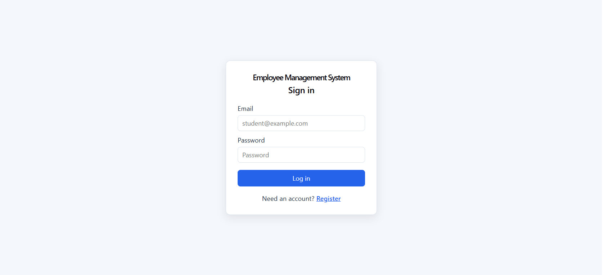
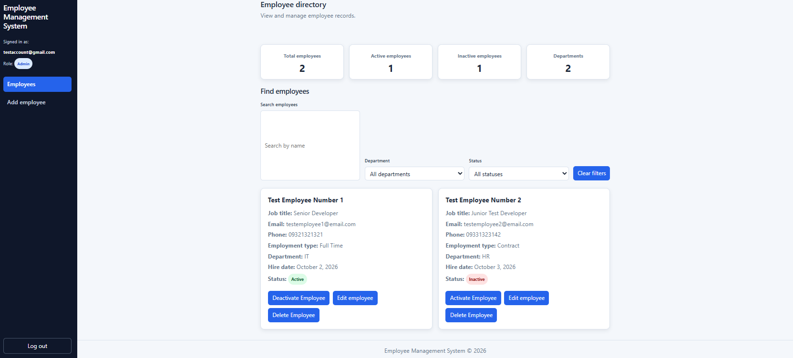
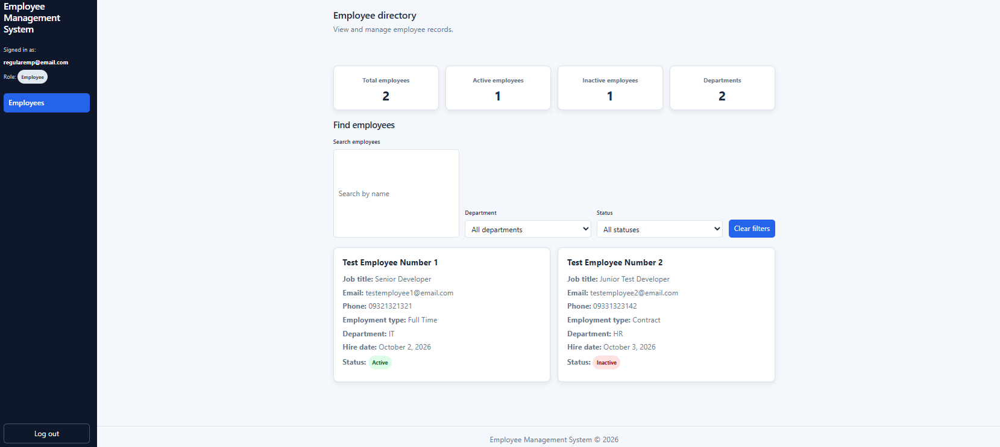
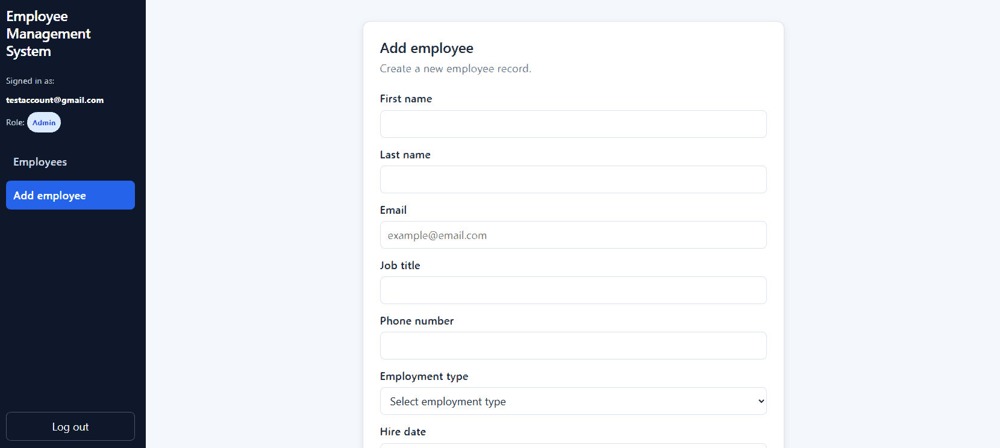
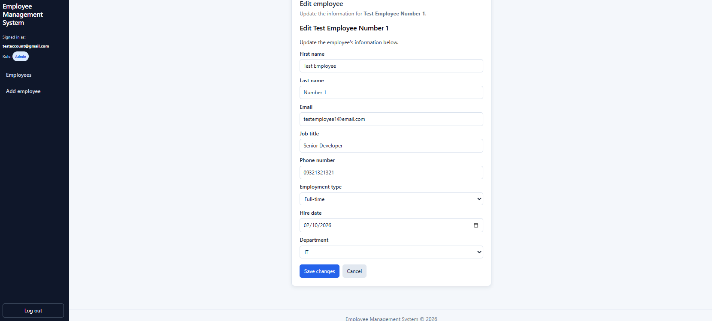
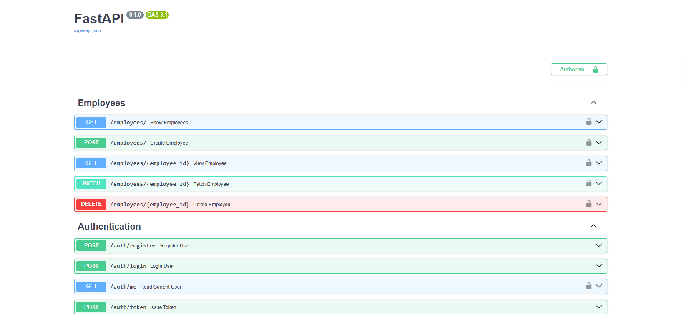

# Employee Management System

A full-stack employee management dashboard built with React, FastAPI, PostgreSQL, SQLAlchemy, JWT authentication, and Docker.

The system supports role-based access control, employee CRUD operations, search and filtering, dashboard statistics, and separate experiences for administrators and regular employees.

## Features

- User registration and login
- JWT-based authentication
- Session restoration after browser refresh
- Role-based authorization
- Admin and regular employee roles
- Employee creation, viewing, editing, status updates, and deletion
- Search by name, email, and job title
- Department and status filtering
- Dashboard summary statistics
- Responsive employee cards
- Form validation and error handling
- Protected routes
- PostgreSQL persistence
- Dockerized FastAPI backend and PostgreSQL database
- Automated backend tests with pytest

## Technology Stack

### Frontend

- React
- Vite
- React Router
- JavaScript
- CSS

### Backend

- Python
- FastAPI
- SQLAlchemy
- Pydantic
- PyJWT
- pwdlib

### Database and Infrastructure

- PostgreSQL
- Docker
- Docker Compose
- pytest

## Architecture

```text
React frontend
    |
    | HTTP requests with JWT bearer token
    v
FastAPI backend
    |
    | SQLAlchemy
    v
PostgreSQL database
```

Authentication flow:

```text
User logs in
    ↓
FastAPI verifies credentials
    ↓
FastAPI creates a JWT
    ↓
React stores the access token
    ↓
React sends the token with protected requests
    ↓
FastAPI validates the token and user role
```

## User Roles

### Administrator

Administrators can:

- View employees
- Create employees
- Edit employee information
- Activate or deactivate employees
- Delete employees
- Search and filter employee records

### Regular Employee

Regular employees can:

- View permitted employee information
- Search and filter employee records
- View dashboard statistics

Regular employees cannot:

- Create employees
- Edit employees
- Delete employees
- Activate or deactivate employees

The frontend hides restricted controls for usability, but FastAPI remains the final authorization authority.

## Employee Fields

Each employee record contains:

- First name
- Last name
- Job title
- Email
- Phone number
- Employment type
- Department
- Hire date
- Active or inactive status
- Created timestamp
- Updated timestamp

Supported employment types:

- Full-time
- Part-time
- Contract
- Intern

## Project Structure

```text
employee-management-system/
│
├── backend/
│   ├── app/
│   │   ├── models/
│   │   │   ├── employee.py
│   │   │   └── user.py
│   │   ├── routes/
│   │   │   ├── auth.py
│   │   │   └── employees.py
│   │   ├── schemas/
│   │   │   ├── employee.py
│   │   │   └── user.py
│   │   ├── database.py
│   │   ├── dependencies.py
│   │   ├── main.py
│   │   └── security.py
│   ├── tests/
│   ├── Dockerfile
│   ├── .dockerignore
│   ├── .env.example
│   └── requirements.txt
│
├── frontend/
│   ├── src/
│   ├── package.json
│   └── vite.config.js
│
├── docker-compose.yml
├── .gitignore
└── README.md
```

## Environment Variables

Create `backend/.env` using the safe example below:

```env
POSTGRES_USER=employee_user
POSTGRES_PASSWORD=replace_with_your_password
POSTGRES_HOST=localhost
POSTGRES_PORT=5433
POSTGRES_DB=employee_management
JWT_SECRET_KEY=replace_with_a_long_random_secret
JWT_ALGORITHM=HS256
JWT_EXPIRE_MINUTES=30
```

When the backend runs inside Docker Compose, the Compose configuration overrides:

```env
POSTGRES_HOST=db
POSTGRES_PORT=5432
```

Never commit `backend/.env` to Git.

## Running with Docker

From the project root:

```powershell
docker compose --env-file .\backend\.env up --build -d
```

Check the running services:

```powershell
docker compose --env-file .\backend\.env ps
```

View backend logs:

```powershell
docker compose --env-file .\backend\.env logs -f backend
```

The backend will be available at:

```text
http://localhost:8000
```

Health check:

```text
http://localhost:8000/health
```

Interactive API documentation:

```text
http://localhost:8000/docs
```

Stop the containers:

```powershell
docker compose --env-file .\backend\.env down
```

PostgreSQL data is stored in a Docker volume so it persists after containers are stopped or restarted.

## Running the Frontend

The frontend currently runs through Vite:

```powershell
cd frontend
npm install
npm run dev
```

The frontend will be available at:

```text
http://localhost:5173
```

The frontend communicates with the FastAPI backend at:

```text
http://127.0.0.1:8000
```

The React frontend is not currently containerized. Docker Compose runs PostgreSQL and FastAPI, while the frontend runs locally through Vite.

## Running the Backend Locally

Create and activate a virtual environment:

```powershell
cd backend
python -m venv .venv
.\.venv\Scripts\Activate.ps1
```

Install dependencies:

```powershell
pip install -r requirements.txt
```

Start FastAPI:

```powershell
uvicorn app.main:app --reload
```

## API Routes

### Authentication

| Method | Route | Description |
|---|---|---|
| GET | `/health` | Health check |
| POST | `/auth/register` | Register a user |
| POST | `/auth/login` | Log in with JSON credentials |
| POST | `/auth/token` | OAuth2-compatible login |
| GET | `/auth/me` | Retrieve the current authenticated user |

### Employees

| Method | Route | Access |
|---|---|---|
| GET | `/employees/` | Authenticated users |
| GET | `/employees/{employee_id}` | Authenticated users |
| POST | `/employees/` | Administrators |
| PATCH | `/employees/{employee_id}` | Administrators |
| DELETE | `/employees/{employee_id}` | Administrators |

The employee list endpoint supports:

- `search`
- `department`
- `status`

Example:

```text
GET /employees/?search=developer&department=IT&status=true
```

## Authentication and Authorization

Passwords are hashed before being stored in PostgreSQL.

After a successful login:

1. FastAPI verifies the email and password.
2. FastAPI creates a JWT access token.
3. React stores the access token.
4. React sends the token in the `Authorization` header.
5. FastAPI validates the token on protected requests.
6. Admin-only routes require the administrator role.

Example authorization header:

```text
Authorization: Bearer <access_token>
```

The application never returns passwords or password hashes through the API.

## Testing

The backend uses an isolated PostgreSQL test database.

Run the complete backend test suite:

```powershell
cd backend
python -m pytest -q
```

The test suite covers:

- Password hashing
- Password verification
- Registration
- Duplicate registration
- Login
- Invalid credentials
- JWT authentication
- `/auth/me`
- Admin authorization
- Regular employee permissions
- Employee creation
- Employee updates
- Duplicate employee emails
- Employee deletion
- Search
- Department filtering
- Status filtering
- Combined filters

Current result:

```text
20 passed
```

## Frontend Verification

Important workflows were manually tested:

- Logged-out redirects
- Successful login
- Invalid login
- Session restoration
- Logout
- Admin dashboard
- Regular employee dashboard
- Employee creation
- Employee editing
- Employee status changes
- Employee deletion
- Search and filtering
- Empty search results
- Responsive layout
- Production build

Build the frontend:

```powershell
cd frontend
npm run build
```

## Security Considerations

- Passwords are hashed before storage.
- JWT authentication protects private routes.
- Admin authorization is enforced by FastAPI.
- Regular users cannot bypass authorization by manually sending requests.
- `.env` files are excluded from Git.
- Passwords, password hashes, JWTs, and secrets are not returned in employee responses.
- The application avoids storing unnecessary sensitive information.

## Known Limitations

- The frontend is not currently included as a Docker Compose service.
- Database schema changes are currently performed manually rather than through Alembic migrations.
- The application does not currently include pagination.
- Phone numbers currently have basic optional and length validation rather than strict international formatting.
- The test client currently produces a non-blocking Starlette/httpx deprecation warning.

## Possible Future Improvements

- Add Alembic database migrations.
- Add pagination and sorting.
- Add department management.
- Add audit logs for administrative actions.
- Add profile pages for users.
- Add password reset functionality.
- Add stronger phone-number validation.
- Add automated frontend tests.
- Containerize the React frontend with Nginx.
- Add continuous integration through GitHub Actions.

## Screenshots

### Login



### Admin Dashboard



### Regular Employee Dashboard



### Add Employee



### Edit Employee



### FastAPI Documentation



## Portfolio Summary

This project demonstrates full-stack application development using React, FastAPI, PostgreSQL, SQLAlchemy, JWT authentication, role-based authorization, Docker, and automated testing.

The project emphasizes secure backend authorization, persistent relational data, REST API design, reusable React components, responsive dashboard design, and practical development workflows.
